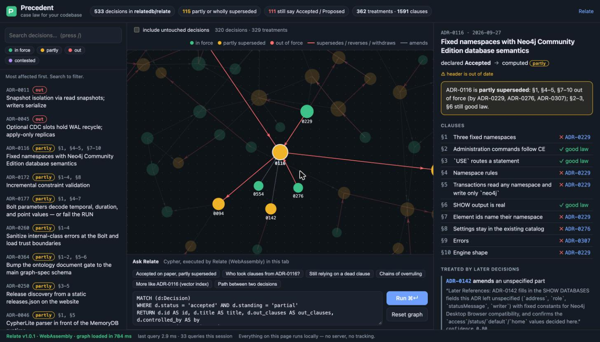
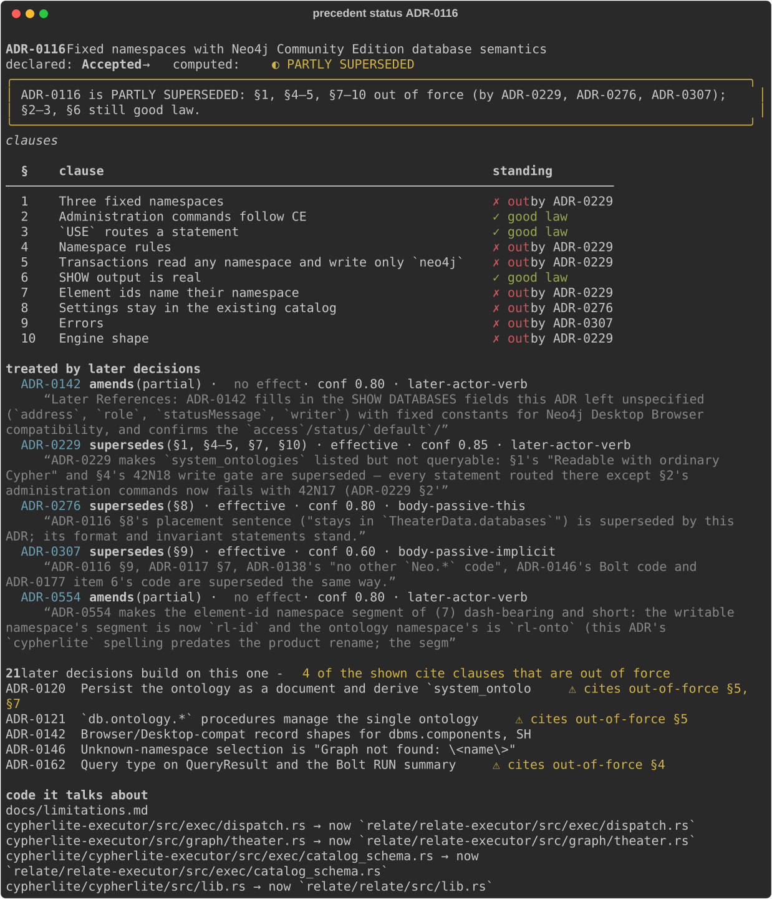
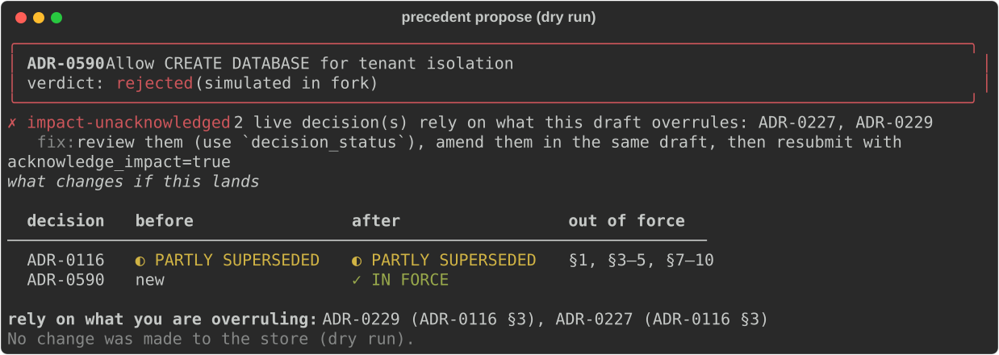
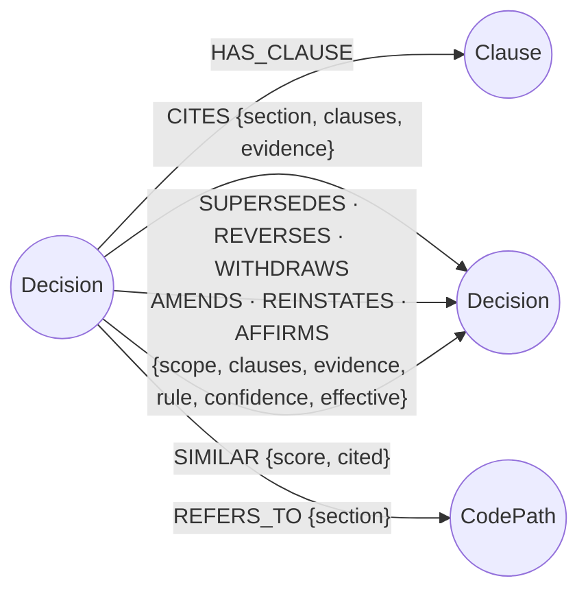

# Precedent

**Case law for your codebase.** Decision records are immutable, so later decisions quietly overrule parts of earlier ones while the old header still says *Accepted*. Precedent reads that prose once, builds the citation graph in [Relate](https://relatedb.ai), and tells you — and your coding agent — which clauses are still good law.

[**▶ Try it in your browser**](https://ZNLong2203.github.io/precedent/) &nbsp;·&nbsp; [Demo video](https://ZNLong2203.github.io/precedent/) &nbsp;·&nbsp; [Method](docs/methodology.md) &nbsp;·&nbsp; [Evaluation](docs/evaluation.md) &nbsp;·&nbsp; [Agent integration](docs/agent-integration.md)



*Everything in that screenshot is answered by Relate compiled to WebAssembly, running in the browser tab — no server.*

## Use case

Teams (and agents) increasingly steer software with decision records: ADRs, RFCs, specs. The records are write-once, so a change of mind is a *new* record that says, in a sentence somewhere inside it, "§4 is superseded". Nothing updates the old one. A reader — human or LLM — who opens the original acts on dead clauses.

We ran Precedent on the real, public decision log of Relate itself — **533 ADRs** in [`relatedb/relate`](https://github.com/relatedb/relate/tree/main/docs/adr):

| | |
|---|---|
| decisions partly or wholly superseded by a later decision | **115 (21.6 %)** |
| …of which the header still says *Accepted* or *Proposed* | **111** |
| flat full-text searches whose top‑5 contain at least one such decision | **74.5 %** of 533 queries |
| tasks where a model, given those documents, builds on an already‑overruled clause (24 tasks × 3 runs, Claude Sonnet 5.5) | **63.9 % → 4.2 %** once `preflight` is in its context; a generic "be careful" note changes nothing (66.7 %) — [details and limits](docs/evaluation.md#8-do-models-rely-on-overruled-clauses-and-does-precedent-change-that) |
| `ADR-0116 — Fixed namespaces…` | declared *Accepted*; **§1, §4–5, §7–10 are out of force** (ADR‑0229, ADR‑0276, ADR‑0307); §2–3, §6 still stand |

Which relationships matter? *treatments* — "A supersedes §4 of B", "C reverses A", "D withdraws part of E" — and the **citations and code paths** around them. That is a graph, and "is this still good law?" is a question about walking it.

## What Precedent does

| | |
|---|---|
| **Standing** | Per *clause*, not per document: in force, partly superseded, out of force, contested. Computed with [grounded argumentation semantics](docs/methodology.md#standing), so "A overruled B, then C overruled A" resolves correctly (B is good law again). |
| **Evidence on every edge** | Each treatment keeps the exact sentence it came from, the rule that fired and a confidence — a human can check any claim in one click. |
| **Preflight for agents** | `preflight(task, paths)` returns the decisions an agent must respect, with stale clauses flagged and the *controlling* decision pulled in, inside a token budget. Served over **MCP**. |
| **A guard for agent‑written decisions** | `propose_decision` writes the draft into the graph inside a Relate **transaction**, recomputes standing on the uncommitted state, and reports which decisions change, who relies on what you are overruling, and errors that each carry a `fix` — then commits or rolls back. A dry run is a *what‑if*. |
| **Overlap finder** | `find_overlaps(draft)` — before an agent writes a decision, it points at the clauses the draft would overrule (declare them) and at ground that is *already* out of force (cite the replacement). A ranking, not a ruling: the agent writes the language, the graph checks the claim. Measured on 55 real overrulings in [the evaluation](docs/evaluation.md#5a-overlap-finder). |
| **Header patches** | `precedent fix-status` turns each stale "Accepted" into a reviewable one‑line diff, in the corpus's own wording (`Superseded in part by ADR‑0229 (§1, §4–5)`). On the real corpus: 111 stale headers → 0, no verdict changes ([verified](docs/evaluation.md#5b-header-patches)). |
| **cite‑check** | Stale statuses, reliance on superseded clauses, ghost file paths, near‑duplicate decisions, temporal impossibilities. CI‑friendly (`--fail-on-warn`). |
| **Browser explorer** | The same graph in your tab, queried with Cypher — [try it](https://ZNLong2203.github.io/precedent/). |



## Try it

**No install** — open the [explorer](https://ZNLong2203.github.io/precedent/): search any decision to see which clauses still hold and who overruled the rest, browse all 533, or see the whole network. The **Query** tab runs your own Cypher on the same graph.

**CLI** (Python ≥ 3.10; [uv](https://docs.astral.sh/uv/) recommended). The store is already in the repo — nothing to build, no keys, no network:

```bash
git clone https://github.com/ZNLong2203/precedent && cd precedent
uv sync
uv run precedent demo                       # 20-second tour
uv run precedent status ADR-0116            # clause-level standing + the quoted evidence
uv run precedent preflight "add support for creating and switching between multiple databases"
uv run precedent overlaps "Allow creating and dropping databases instead of three fixed namespaces"   # before you write a decision
uv run precedent fix-status --limit 5       # which headers still say Accepted, and what they should say (--diff for a patch)
uv run precedent cite-check                 # 300+ structural findings, grouped
uv run precedent propose examples/proposal-multi-tenant.json    # what-if: dry run of a draft ADR
```

**Inspect the raw Relate store with the stock `relate` CLI** (read-only, so git stays clean):

```bash
curl -sSfL https://relatedb.ai/install.sh | bash
relate -d data/relate-adr.rl --read-only "MATCH (d:Decision) WHERE d.status = 'accepted' AND d.standing = 'partial'
  RETURN d.id, d.title, d.out_clauses ORDER BY size(d.out_clauses) DESC LIMIT 10"
relate serve --database data/relate-adr.rl --read-only --bolt 7687 --http 7474 --mcp 7475 --auth none   # Neo4j Browser works too
```

**With your coding agent** — the repo ships a project‑scoped [`.mcp.json`](.mcp.json) and a [Claude Code skill](skills/precedent/SKILL.md). Open the repo in Claude Code, approve the `precedent` server, and ask: *"Add support for multiple databases to Relate — what do I have to respect?"* → [what the agent sees](docs/agent-integration.md).



## How it uses Relate

- **Mode: single file** (`data/relate-adr.rl`, 17 MB, committed).
- **Why this mode:**
  - *Not `:memory:`* — judges must be able to open the graph, and the standing it holds is the product.
  - *Not a directory* — one file is the unit of sharing, of `git` history, and of **forking**: a `.rl` bundle copy is a complete, writable fork of the graph, which is how the guard simulates a draft against a read‑only store without touching it.
  - The stock `relate` CLI, `relate serve` (Bolt/HTTP/MCP) and the Neo4j driver all open the committed file as‑is.
- **What the graph models** — decisions as cases, clauses as holdings, treatments as how later cases treat them:



  533 `Decision`, 1 591 `Clause`, 697 `CodePath` nodes; 3 741 `CITES`, 362 treatment edges, 2 548 `SIMILAR`. `standing`, `out_clauses` and `controlled_by` are *derived* by [`standing.py`](src/precedent/standing.py) and written back, so plain Cypher answers "what is still good law?".

| Relate capability | Where Precedent uses it |
|---|---|
| Embedded Python library (`relate-db`) | the whole app runs in‑process — no server to start ([`graph.py`](src/precedent/graph.py)) |
| Single‑file `.rl` store, constraints, persisted indexes | [`graph.build`](src/precedent/graph.py); unique `Decision.id`, `Clause.key`, `CodePath.path` |
| **Full‑text** (BM25) + **vector index / `SEARCH`** | hybrid retrieval: decisions + clauses + 96‑d offline LSA vectors fused with RRF ([`api.search`](src/precedent/api.py)); "More like this" in the browser uses the stored vector as the query |
| Cypher: quantified paths, `shortestPath`, list predicates | `explain`, cite‑check, the Ask Relate examples |
| **Explicit transactions + rollback**, read‑your‑writes | [`guard.propose`](src/precedent/guard.py): write the draft, recompute standing on uncommitted state, commit or roll back |
| Whole store is one file → cheap **fork** | what‑if on a read‑only store ([`guard.scratch_copy`](src/precedent/guard.py)) |
| `read_only=True`, many readers / one writer | CLI and MCP open read‑only; the lock error is explained ([`StoreLocked`](src/precedent/graph.py)) |
| **WebAssembly** build (`@relate/relate-wasm`) | the [explorer](docs/index.html): every query runs in the tab |
| **MCP** | our intent‑level server ([`mcp_server.py`](src/precedent/mcp_server.py), in‑process Relate) on top of Relate's own `read_cypher`/`write_cypher` (`relate serve --mcp`) |
| Bolt / HTTP via `relate serve` | open the same file in Neo4j Browser or any Neo4j driver |

## Setup and run

Prerequisites: Python 3.10+, [uv](https://docs.astral.sh/uv/) (or `pip install -e .`). Optional: the `relate` CLI and Node (only to re‑vendor the WASM bundle).

```bash
uv sync --extra dev          # install
uv run pytest                # 50 tests, ~7 s (real Relate store, real MCP calls, 31 real ADRs)
uv run precedent --help
```

To build a store for **your own** decision records (`NNNN-title.md`, ADR style):

```bash
uv run precedent index /path/to/repo --adr-dir docs/adr --out my.rl --name my/repo
uv run precedent cite-check --store my.rl
uv run precedent mcp --store my.rl            # serve the tools to an agent (stdio)
```

Reproduce the committed store and every number in the docs from the pinned upstream commit: `make data eval` (clones `relatedb/relate` at `1ebb65e`).

## Where the data lives

| Path | What |
|---|---|
| [`data/relate-adr.rl`](data/relate-adr.rl) | **the persistent Relate store** (single file; `relate info -d data/relate-adr.rl`) |
| [`data/relate-adr.lsa.npz`](data/relate-adr.lsa.npz) | the LSA basis used to embed queries for the vector index |
| [`data/gold/`](data/gold/) | all 178 negative treatments with an audit label ([how](data/gold/README.md)) |
| [`docs/data/graph.json`](docs/data/graph.json) | the browser export of the same store |
| [`tests/fixtures/relate-adr/`](tests/fixtures/relate-adr/) | 31 real ADRs used for regression tests |

## How well does it work?

Full numbers and caveats in [docs/evaluation.md](docs/evaluation.md). Headlines:

- **Precision of the 178 negative treatments** (every one read against its evidence): 176 correct, 1 plausible, 1 wrong — *but* the rules were tuned on this audit; held‑out precision is unmeasured.
- **Agent behaviour** (24 tasks, 3 runs each, a model with no tools): relied on an overruled clause in 46 of 72 runs with the documents alone, 48 of 72 with a generic warning, **3 of 72** with `preflight`. The tasks were chosen where such a clause exists, only what the model *says* it relies on was scored, and the one residual miss is a decision `preflight` did not surface — see [§8](docs/evaluation.md#8-do-models-rely-on-overruled-clauses-and-does-precedent-change-that).
- **Recall** of explicit overruling statements ≈ **91–97 %** on a held‑out sample (statements phrased without any trigger word are invisible to that estimate).
- **0 of 184** dated treatments are temporally impossible (actor older than target).
- Latency on the real graph: `status` 0.35 ms, hybrid search / preflight ≈ 45 ms (p50).

## Limitations (honest list)

- Rule‑based extraction tuned on **one corpus** (Relate's ADRs, written in a very regular style). Other styles will extract less; the evidence‑on‑every‑edge design makes errors cheap to spot. No LLM is used at runtime.
- Clause granularity needs numbered clauses in `## Decision`; otherwise supersession is tracked as "a part of it".
- Relate is single‑process and keeps the graph in RAM: one writer at a time (readers are fine), working set must fit in memory — a non‑issue for decision records.
- The corpus never contains an overruling that is itself fully overruled, so the *restoration* path of the standing engine is covered by unit tests, not by the demo data.
- The browser explorer is a sandbox copy; edits there never leave the tab.

## Built with AI

This project was designed and written with **Claude Code (Claude Sonnet 5.5)**, including the extractor, the standing engine, the MCP server and the explorer. The gold audit labels were also produced by the assistant (disclosed in [`data/gold/README.md`](data/gold/README.md)). The shipped product makes **no** model calls. The one place a model is called is the *evaluation*: `scripts/agent_eval.py run` feeds prompts to Claude Sonnet 5.5 through the `claude` CLI as the model under test (prompts, raw answers and per-call metadata are committed in [`data/agent-eval/`](data/agent-eval/)).

## License and attribution

Apache‑2.0 ([LICENSE](LICENSE)). The decision records analysed are © Neo4j, Inc. and contributors, Apache‑2.0, from [`relatedb/relate`](https://github.com/relatedb/relate); see [NOTICE](NOTICE). Vendored: `@relate/relate-wasm` (Apache‑2.0), `force-graph` (MIT). Relate and Neo4j are trademarks of Neo4j, Inc.; this project is not endorsed by Neo4j.
